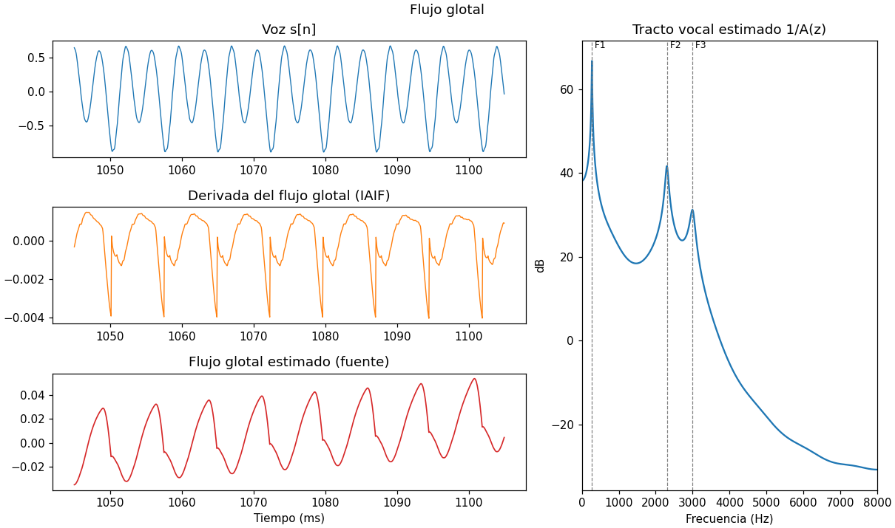
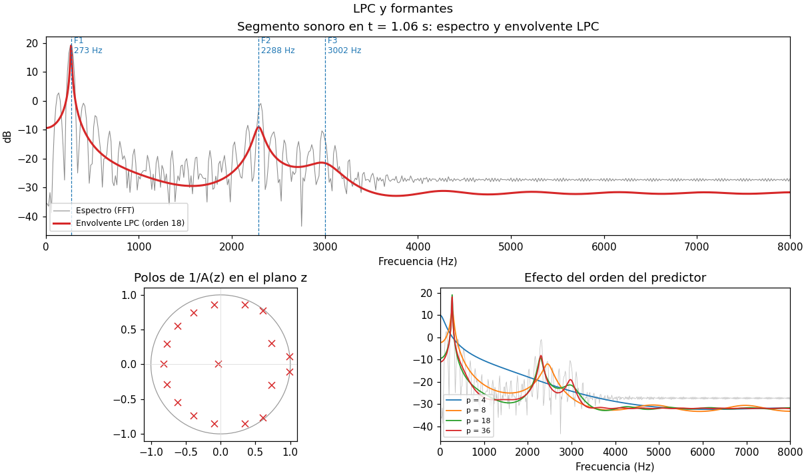
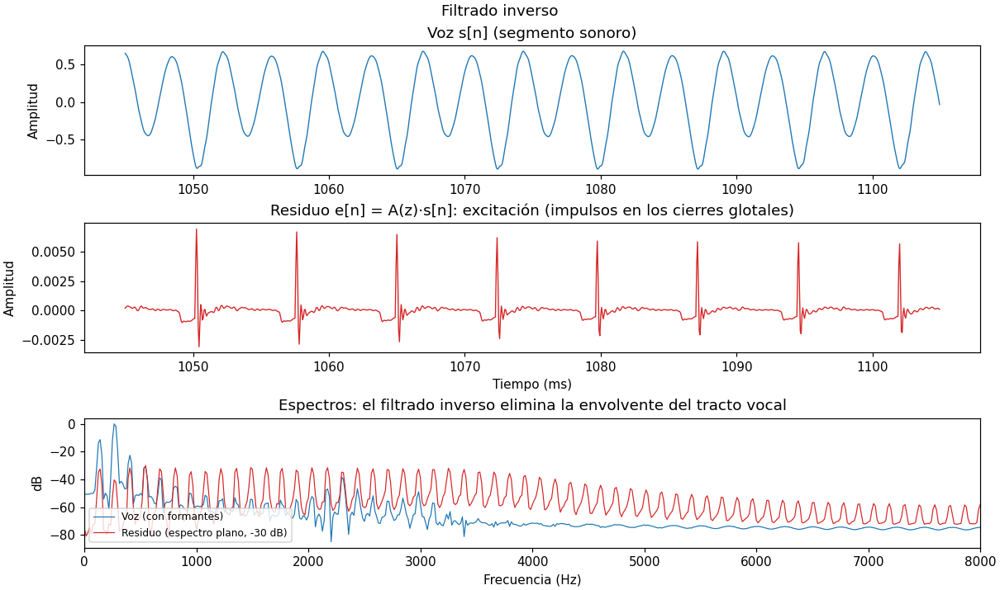

#  Modulador de voz

Aplicación de escritorio en **Python** para **analizar y modificar la voz**: cambia el tono en semitonos, la velocidad (x0,5 · x1,5 · x2), aplica efectos por síntesis LPC, añade o elimina ruido, y muestra paso a paso el análisis de la señal: enventanado, energía, pitch, envolvente LPC, formantes, filtrado inverso, **separación del tracto vocal y del flujo glotal (IAIF)** y cepstrum.

Proyecto de la asignatura **Biometría de la Voz**, realizado en equipo por **2 personas**.


---

## Funcionalidades

### Modulación de la voz
| Función | Técnica | Módulo |
|---|---|---|
| Subir / bajar el tono de -12 a +12 semitonos sin cambiar la duración | **TD-PSOLA** (*Pitch-Synchronous Overlap-Add*) o **phase vocoder** + remuestreo | [`modificacion.py`](modulador_voz/modificacion.py) |
| Velocidad **x0,5 · x1 · x1,5 · x2** (botones) | **Phase vocoder** (mantiene el tono) o remuestreo (cambia el tono, efecto «cinta») | [`modificacion.py`](modulador_voz/modificacion.py) |
| Efectos **robot**, **susurro** y **vocoder LPC** | Síntesis LPC: filtro del tracto vocal excitado por tren de impulsos o ruido | [`lpc.py`](modulador_voz/lpc.py) |
| Añadir ruido blanco o rosa con **SNR** controlada | Escalado de potencia | [`ruido.py`](modulador_voz/ruido.py) |
| Reducción de ruido | **Sustracción espectral** (Boll) con sobresustracción y suelo espectral | [`ruido.py`](modulador_voz/ruido.py) |
| Cargar, reproducir, guardar y **convertir** entre WAV, FLAC, OGG y MP3 | `soundfile` + `sounddevice` | [`audio_io.py`](modulador_voz/audio_io.py) |

### Análisis de la señal (gráficas)
| Gráfica | Qué muestra | Módulo |
|---|---|---|
| Señal y espectrograma | Forma de onda y espectrogramas de **banda ancha** (formantes) y **banda estrecha** (armónicos), con **preénfasis** opcional | [`analisis.py`](modulador_voz/analisis.py) |
| Energía y ZCR | **Enventanado** en tramas, **energía a corto plazo**, **tasa de cruces por cero** y clasificación **silencio / sorda / sonora** | [`analisis.py`](modulador_voz/analisis.py) |
| Pitch | Contorno de F0 y comparación de tres métodos: **autocorrelación**, **AMDF** y **cepstrum** | [`pitch.py`](modulador_voz/pitch.py) |
| LPC y formantes | Coeficientes LPC por **Levinson-Durbin**, **envolvente LPC** sobre el espectro, **formantes** F1-F3, polos en el plano z y efecto del orden | [`lpc.py`](modulador_voz/lpc.py) |
| Filtrado inverso | **Residuo LPC** (excitación) frente a la voz y sus espectros | [`lpc.py`](modulador_voz/lpc.py) |
| Flujo glotal | **Separación tracto vocal / fuente glotal** con **IAIF**: derivada del flujo glotal, flujo glotal y respuesta del tracto vocal | [`lpc.py`](modulador_voz/lpc.py) |
| Cepstrum | **Cepstrum real**, pico de pitch y **liftering** (envolvente frente a excitación) | [`cepstrum.py`](modulador_voz/cepstrum.py) |
| Comparar | Original frente a procesada: forma de onda, espectrograma y F0 | [`graficas.py`](modulador_voz/graficas.py) |

En la interfaz se pueden cambiar el **tipo de ventana** (rectangular, Hamming, Hann, Blackman), la **duración de la trama**, el **salto**, el **orden LPC**, el **preénfasis** y el **método de pitch**.

---

## Capturas

| Separación del flujo glotal (IAIF) | Envolvente LPC y formantes |
|---|---|
|  |  |
| **Energía, ZCR y decisión sonora / sorda** | **Pitch con tres métodos** |
|  |  |
| **Filtrado inverso (residuo LPC)** | **Cepstrum y liftering** |
|  |  |

---

## Fundamentos

**Modelo fuente-filtro.** La voz se modela como una excitación (el flujo de aire glotal en los sonidos sonoros, ruido en los sordos) filtrada por el tracto vocal. En el dominio z:

$$S(z) = G(z)\,V(z)\,R(z)$$

donde $G$ es el pulso glotal, $V$ el tracto vocal y $R$ la radiación labial (≈ derivador).

**LPC.** El tracto vocal se aproxima con un filtro todo polos $V(z) = \dfrac{g}{A(z)}$, con $A(z) = 1 + \sum_{k=1}^{p} a_k z^{-k}$. Los coeficientes minimizan el error de predicción $e[n] = s[n] + \sum_k a_k\, s[n-k]$, lo que lleva a las ecuaciones de Yule-Walker, que se resuelven con **Levinson-Durbin**. Las raíces de $A(z)$ dan los **formantes**: frecuencia $\theta\,f_s/2\pi$ y ancho de banda $-\ln|r|\,f_s/\pi$.

**Filtrado inverso e IAIF.** Filtrar la voz con $A(z)$ elimina el tracto vocal y deja la excitación (residuo). **IAIF** (*Iterative Adaptive Inverse Filtering*, Alku 1992) repite el proceso dos veces, modelando primero la inclinación espectral glotal, para obtener un modelo del tracto vocal más limpio. Al integrar el resultado se obtiene el **flujo glotal**.

**Cepstrum.** $c[q] = \mathcal{F}^{-1}\{\log|X(f)|\}$. El logaritmo convierte el producto fuente × filtro en una suma: el tracto vocal ocupa las quefrencias bajas y la excitación produce un pico en el periodo fundamental.

**Cambio de tono.** Subir $n$ semitonos multiplica F0 por $2^{n/12}$. **TD-PSOLA** extrae segmentos de dos periodos centrados en cada marca de pitch y los vuelve a sumar con una separación $T/\alpha$, lo que cambia F0 sin alterar la duración ni los formantes.

**Phase vocoder.** Cambia la duración interpolando los módulos de la STFT y reconstruyendo la fase con la frecuencia instantánea de cada canal. Combinado con un remuestreo permite cambiar el tono sin cambiar la duración.

---

## Instalación

Requiere **Python 3.10 o superior**.

```bash
git clone https://github.com/RespinosaDev/modulador-de-voz.git
cd modulador-de-voz
python -m venv .venv
```

Activa el entorno virtual:

```bash
# Windows
.venv\Scripts\activate
# Linux / macOS
source .venv/bin/activate
```

Instala las dependencias:

```bash
pip install -r requirements.txt
```

> En Windows 11 con el **Control inteligente de aplicaciones** activado, versiones muy recientes de NumPy o SciPy pueden bloquearse al importarlas. Las versiones de `requirements.txt` están probadas y funcionan.

## Uso

```bash
python main.py
```

1. Pulsa **Cargar audio…** (WAV, FLAC, OGG o MP3) o **Audio de ejemplo**.
2. Mueve el control de **semitonos**, elige **PSOLA** o **Phase vocoder** y pulsa un botón de **velocidad** o **Aplicar modulación**.
3. Aplica efectos (**Robot**, **Susurro**, **Vocoder LPC**, **Añadir ruido**, **Sustracción espectral**). Se encadenan sobre la señal procesada.
4. Escucha con **▶ Original** / **▶ Procesada**.
5. Pulsa cualquier botón de gráfica para ver el análisis de la señal original o de la procesada.
6. **Guardar / convertir formato…** guarda la señal en el formato elegido por la extensión.

Las funciones también se pueden usar desde código:

```python
from modulador_voz.audio_io import cargar_audio, guardar_audio
from modulador_voz.modificacion import cambiar_semitonos, cambiar_velocidad
from modulador_voz.lpc import iaif, sintesis_lpc

x, fs = cargar_audio("ejemplos/frase_sintetica.wav")
y = cambiar_semitonos(x, fs, -4, metodo="psola")
y = cambiar_velocidad(y, fs, 1.5, mantener_tono=True)
guardar_audio("salida.mp3", y, fs)
```

## Estructura

```
modulador-de-voz/
├── main.py                  # Punto de entrada (interfaz gráfica)
├── modulador_voz/
│   ├── analisis.py          # Preénfasis, enventanado, energía, ZCR, sonoro/sordo, espectrograma
│   ├── pitch.py             # F0 por autocorrelación y AMDF
│   ├── cepstrum.py          # Cepstrum real, liftering y F0 cepstral
│   ├── lpc.py               # Levinson-Durbin, envolvente, formantes, filtrado inverso, IAIF, síntesis LPC
│   ├── modificacion.py      # TD-PSOLA, phase vocoder, semitonos y velocidad
│   ├── ruido.py             # Ruido con SNR y sustracción espectral
│   ├── audio_io.py          # Cargar, guardar, convertir y reproducir
│   ├── graficas.py          # Gráficas de análisis (matplotlib)
│   ├── interfaz.py          # Interfaz Tkinter
│   └── sintetico.py         # Vocales sintéticas (pulso de Rosenberg + formantes)
├── tests/                   # Pruebas con pytest
├── scripts/                 # Generación de figuras y capturas
├── ejemplos/                # Audios de ejemplo
└── docs/img/                # Imágenes del README
```

## Pruebas

Las pruebas usan voz sintética, de la que se conocen la fuente y el filtro, para comprobar que los algoritmos recuperan los valores reales: F0 (los tres métodos), formantes, coeficientes de un proceso AR, la derivada del flujo glotal con IAIF, el cambio de tono en semitonos (PSOLA y phase vocoder), la duración tras el cambio de velocidad, la SNR y la mejora de la sustracción espectral.

```bash
pip install -r requirements-dev.txt
pytest
```

## Tecnologías

Python · NumPy · SciPy · Matplotlib · Tkinter · soundfile · sounddevice · pytest
