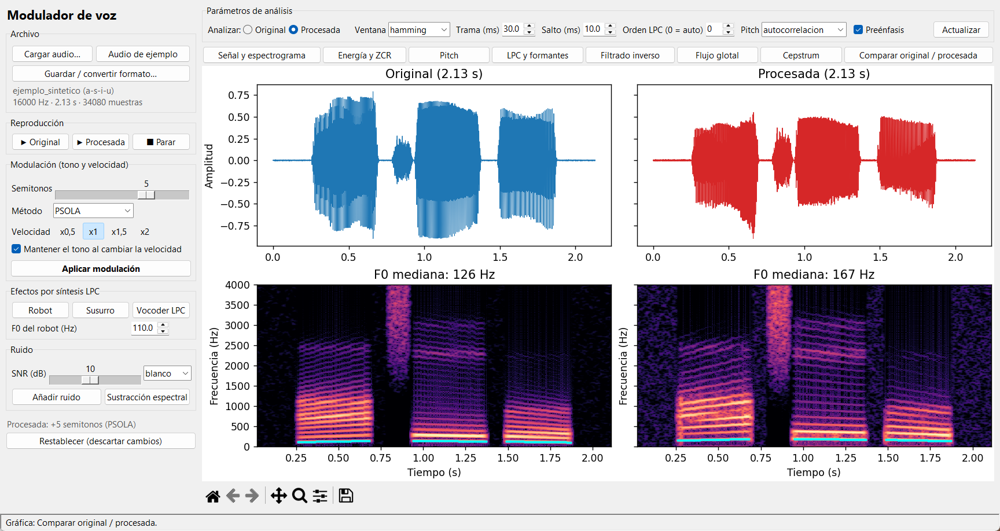
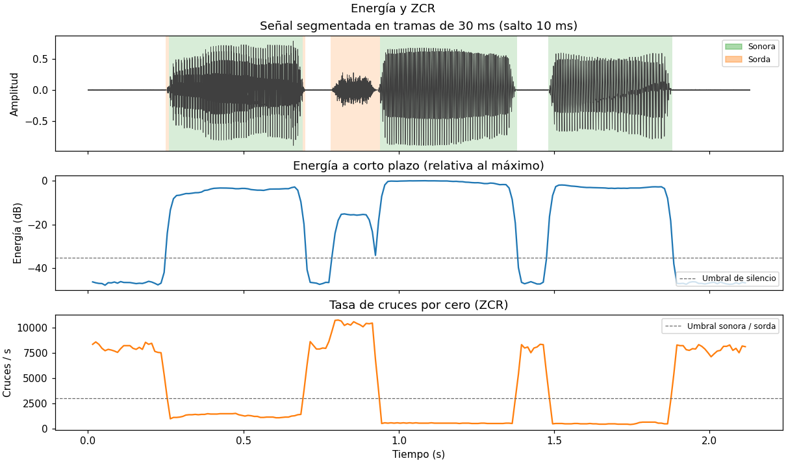
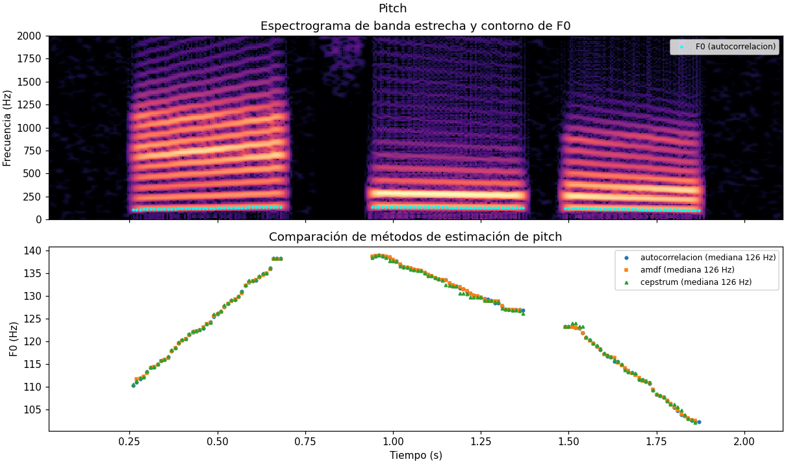
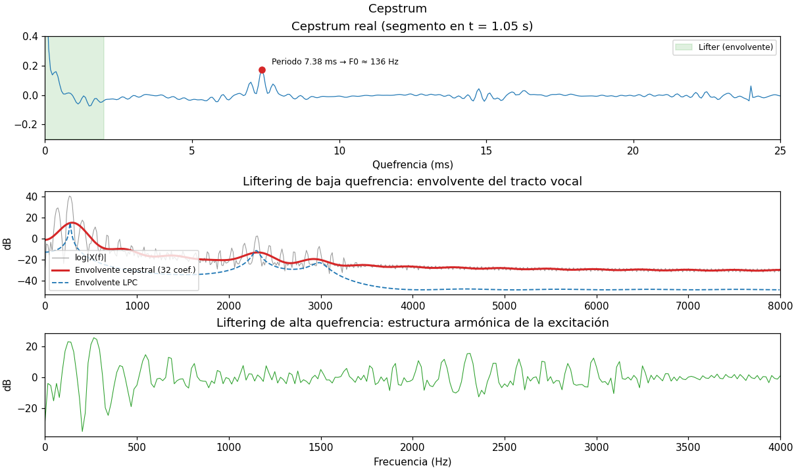

# Modulador de voz

Aplicación de escritorio en **Python** para **modificar y analizar la voz**. Puedes cargar un audio y cambiarle el tono en semitonos o la velocidad (x0,5, x1,5 o x2), ponerle efectos como voz de robot o susurro, añadirle ruido o quitárselo, y guardarlo en otro formato. También saca las gráficas de todo el análisis que vimos en clase: enventanado, energía, pitch, LPC y formantes, filtrado inverso, **separación del tracto vocal y del flujo glotal** y cepstrum.

Es el proyecto de la asignatura **Biometría de la Voz** del Grado en Ingeniería Informática (UPM). Lo hicimos entre **2 personas**.



---

## Qué se puede hacer

### Modificar la voz

| Función | Cómo está hecho | Código |
|---|---|---|
| Subir o bajar el tono de -12 a +12 semitonos sin cambiar la duración | **TD-PSOLA** o **phase vocoder** + remuestreo (se puede elegir) | [`modificacion.py`](modulador_voz/modificacion.py) |
| Botones de velocidad **x0,5, x1, x1,5 y x2** | **Phase vocoder** si quieres mantener el tono, o remuestreo simple si no (suena como una cinta acelerada) | [`modificacion.py`](modulador_voz/modificacion.py) |
| Efectos de **robot**, **susurro** y **vocoder LPC** | Síntesis LPC: el filtro del tracto vocal de cada trama se excita con un tren de impulsos o con ruido | [`lpc.py`](modulador_voz/lpc.py) |
| Añadir ruido blanco o rosa con una **SNR** concreta | Se escala el ruido según la potencia de la señal | [`ruido.py`](modulador_voz/ruido.py) |
| Quitar ruido | **Sustracción espectral** | [`ruido.py`](modulador_voz/ruido.py) |
| Cargar, escuchar, guardar y **convertir** entre WAV, FLAC, OGG y MP3 | `soundfile` y `sounddevice` | [`audio_io.py`](modulador_voz/audio_io.py) |

### Analizar la señal

Cada análisis tiene su botón en la interfaz y se puede hacer sobre la señal original o sobre la modificada.

| Gráfica | Qué enseña | Código |
|---|---|---|
| Señal y espectrograma | La forma de onda y los espectrogramas de **banda ancha** (se ven los formantes) y de **banda estrecha** (se ven los armónicos). Con **preénfasis** opcional | [`analisis.py`](modulador_voz/analisis.py) |
| Energía y ZCR | La señal dividida en **ventanas**, la **energía a corto plazo**, la **tasa de cruces por cero** y qué tramos son **silencio, sordos o sonoros** | [`analisis.py`](modulador_voz/analisis.py) |
| Pitch | El contorno de F0, comparando tres métodos: **autocorrelación**, **AMDF** y **cepstrum** | [`pitch.py`](modulador_voz/pitch.py) |
| LPC y formantes | Los coeficientes LPC (**Levinson-Durbin**), la **envolvente LPC** sobre el espectro, los **formantes** F1-F3, los polos y cómo cambia la envolvente con el orden | [`lpc.py`](modulador_voz/lpc.py) |
| Filtrado inverso | El **residuo LPC**, es decir, lo que queda al quitarle el tracto vocal a la voz | [`lpc.py`](modulador_voz/lpc.py) |
| Flujo glotal | La **separación entre el tracto vocal y la fuente glotal** con **IAIF**: la derivada del flujo glotal, el flujo glotal y la respuesta del tracto vocal | [`lpc.py`](modulador_voz/lpc.py) |
| Cepstrum | El **cepstrum real**, el pico del pitch y el **liftering** para separar la envolvente de la excitación | [`cepstrum.py`](modulador_voz/cepstrum.py) |
| Comparar | La señal original al lado de la modificada: forma de onda, espectrograma y F0 | [`graficas.py`](modulador_voz/graficas.py) |

Desde la interfaz se pueden cambiar el **tipo de ventana** (rectangular, Hamming, Hann o Blackman), la **duración de la trama**, el **salto**, el **orden LPC**, el **preénfasis** y el **método de pitch**.

---

## Capturas

| Separación del flujo glotal (IAIF) | Envolvente LPC y formantes |
|---|---|
|  |  |
| **Energía, ZCR y tramos sonoros / sordos** | **Pitch con los tres métodos** |
|  |  |
| **Filtrado inverso (residuo LPC)** | **Cepstrum y liftering** |
|  |  |

---

## Un poco de teoría

**Modelo fuente-filtro.** La idea de la que parte casi todo el proyecto es que la voz es una excitación (el aire que sale de la glotis en los sonidos sonoros, o ruido en los sordos) que pasa por el tracto vocal, que actúa como un filtro:

$$S(z) = G(z)\,V(z)\,R(z)$$

$G$ es el pulso glotal, $V$ el tracto vocal y $R$ la radiación de los labios, que se comporta más o menos como un derivador.

**LPC.** El tracto vocal se aproxima con un filtro solo de polos, $V(z) = \dfrac{g}{A(z)}$ con $A(z) = 1 + \sum_{k=1}^{p} a_k z^{-k}$. Los coeficientes son los que hacen mínimo el error de predicción $e[n] = s[n] + \sum_k a_k\, s[n-k]$, y se calculan con **Levinson-Durbin**. Las raíces de $A(z)$ dan los **formantes**: la frecuencia sale del ángulo del polo ($\theta\,f_s/2\pi$) y el ancho de banda de su módulo ($-\ln|r|\,f_s/\pi$).

**Filtrado inverso e IAIF.** Si filtras la voz con $A(z)$ quitas el efecto del tracto vocal y te queda la excitación. **IAIF** (*Iterative Adaptive Inverse Filtering*) hace esto dos veces, quitando primero la inclinación del espectro que mete la glotis, para que el modelo del tracto vocal salga más limpio. Integrando el resultado se obtiene el **flujo glotal**.

**Cepstrum.** $c[q] = \mathcal{F}^{-1}\{\log|X(f)|\}$. Al tomar el logaritmo, el producto fuente × filtro pasa a ser una suma: el tracto vocal se queda en las quefrencias bajas y la excitación da un pico en el periodo fundamental.

**Cambio de tono.** Subir $n$ semitonos es multiplicar F0 por $2^{n/12}$. **TD-PSOLA** recorta trozos de dos periodos centrados en cada marca de pitch y los vuelve a sumar más juntos o más separados ($T/\alpha$). Así cambia el tono pero no la duración ni los formantes.

**Phase vocoder.** Para cambiar la duración se interpolan los módulos de la STFT y se reconstruye la fase a partir de la frecuencia instantánea de cada canal. Si después se remuestrea, sirve también para cambiar el tono sin cambiar la duración.

---

## Instalación

Hace falta **Python 3.10 o superior**.

```bash
git clone https://github.com/RespinosaDev/modulador-de-voz.git
cd modulador-de-voz
python -m venv .venv
```

Activa el entorno virtual:

```bash
# Windows
.venv\Scripts\activate
# Linux / macOS
source .venv/bin/activate
```

Instala las dependencias:

```bash
pip install -r requirements.txt
```

> Si usas Windows 11 con el **Control inteligente de aplicaciones** activado, puede que las versiones más nuevas de NumPy o SciPy se bloqueen al importarlas. Por eso `requirements.txt` fija unas versiones algo más antiguas con las que sí funciona.

## Cómo se usa

```bash
python main.py
```

1. Pulsa **Cargar audio…** (WAV, FLAC, OGG o MP3) o **Audio de ejemplo** si no tienes ninguno a mano.
2. Elige los **semitonos** y el método (**PSOLA** o **Phase vocoder**) y pulsa un botón de **velocidad** o **Aplicar modulación**.
3. Si quieres, añade efectos: **Robot**, **Susurro**, **Vocoder LPC**, **Añadir ruido** o **Sustracción espectral**. Se van aplicando uno detrás de otro sobre la señal modificada.
4. Escúchala con los botones de **Original** y **Procesada**.
5. Pulsa cualquier botón de gráfica para ver el análisis.
6. Con **Guardar / convertir formato…** la guardas en el formato que pongas en la extensión.

Las funciones también se pueden usar directamente desde Python:

```python
from modulador_voz.audio_io import cargar_audio, guardar_audio
from modulador_voz.modificacion import cambiar_semitonos, cambiar_velocidad

x, fs = cargar_audio("ejemplos/frase_sintetica.wav")
y = cambiar_semitonos(x, fs, -4, metodo="psola")
y = cambiar_velocidad(y, fs, 1.5, mantener_tono=True)
guardar_audio("salida.mp3", y, fs)
```

## Estructura

```
modulador-de-voz/
├── main.py                  # Arranca la interfaz
├── modulador_voz/
│   ├── analisis.py          # Preénfasis, enventanado, energía, ZCR, sonoro/sordo, espectrograma
│   ├── pitch.py             # F0 por autocorrelación y AMDF
│   ├── cepstrum.py          # Cepstrum real, liftering y F0 por cepstrum
│   ├── lpc.py               # Levinson-Durbin, envolvente, formantes, filtrado inverso, IAIF, síntesis LPC
│   ├── modificacion.py      # TD-PSOLA, phase vocoder, semitonos y velocidad
│   ├── ruido.py             # Ruido con SNR y sustracción espectral
│   ├── audio_io.py          # Cargar, guardar, convertir y reproducir
│   ├── graficas.py          # Gráficas del análisis (matplotlib)
│   ├── interfaz.py          # Interfaz con Tkinter
│   └── sintetico.py         # Vocales sintéticas para las pruebas
├── tests/                   # Pruebas con pytest
├── scripts/                 # Scripts para generar las figuras y capturas del README
├── ejemplos/                # Audios de ejemplo
└── docs/img/                # Imágenes del README
```

## Pruebas

Para comprobar que los algoritmos funcionan, los tests usan **vocales sintéticas**: como sabemos exactamente qué pitch, formantes y flujo glotal tienen, se puede mirar si lo que calcula el programa coincide. Se prueba el pitch con los tres métodos, los formantes, la derivada del flujo glotal con IAIF, que el cambio de semitonos dé el tono correcto (con PSOLA y con phase vocoder), la duración después de cambiar la velocidad, la SNR del ruido añadido y que la sustracción espectral mejore la señal.

```bash
pip install -r requirements-dev.txt
pytest
```

## Tecnologías

Python · NumPy · SciPy · Matplotlib · Tkinter · soundfile · sounddevice · pytest
